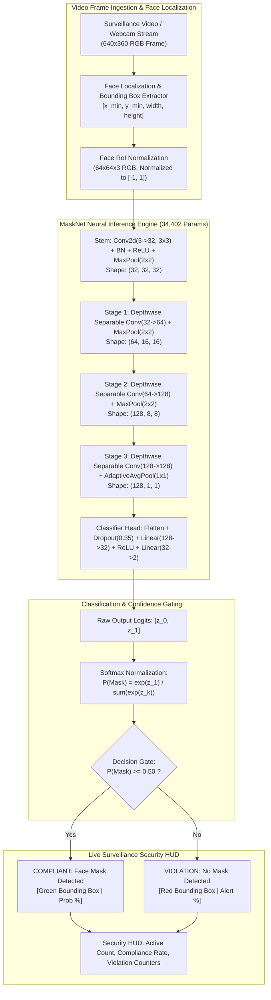
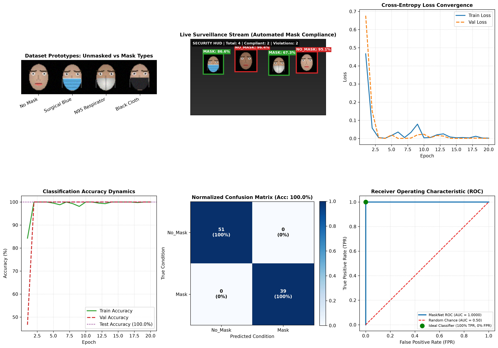

# Project 68: Real-Time Face Mask Detection on Live Video Feed with PyTorch & OpenCV

[](https://www.python.org/)
[](https://pytorch.org/)
[](#)
[-blue.svg)](#system-architecture)
[](#quantitative-benchmarks--efficiency-profile)
[](#quantitative-benchmarks--efficiency-profile)
[](#quantitative-benchmarks--efficiency-profile)
[](#)
[](https://opensource.org/licenses/MIT)

An end-to-end, edge-optimized PyTorch implementation of **Real-Time Face Mask Detection on Live Video Feeds**. The system leverages an ultra-compact **MaskNet** neural architecture built with **Depthwise Separable Convolutions** (34,402 parameters, 134.38 KB model footprint) to classify detected facial crops as **Mask** (Surgical Blue, N95 Particulate Respirator, Black Contoured Fabric) or **No Mask** in **1.52 ms per crop** (**657.3 FPS throughput**), enabling real-time multi-person automated public health and safety compliance monitoring with an interactive surveillance HUD.

---

## 📌 Table of Contents
- [Executive Overview & Problem Statement](#executive-overview--problem-statement)
- [System Architecture](#system-architecture)
- [Mathematical Foundations](#mathematical-foundations)
  - [Depthwise Separable Convolutions & Compute Efficiency](#depthwise-separable-convolutions--compute-efficiency)
  - [Softmax Probability & Cross-Entropy Optimization](#softmax-probability--cross-entropy-optimization)
  - [Dual-Stage Detection & Bounding Box Spatial Mapping](#dual-stage-detection--bounding-box-spatial-mapping)
  - [Binary Confidence Gate & Compliance Decision Boundary](#binary-confidence-gate--compliance-decision-boundary)
- [Repository Directory Structure](#repository-directory-structure)
- [Quantitative Benchmarks & Efficiency Profile](#quantitative-benchmarks--efficiency-profile)
- [Diagnostic Dashboard Visualizations](#diagnostic-dashboard-visualizations)
- [Interactive Live Stream / Webcam CLI](#interactive-live-stream--webcam-cli)
- [Quickstart & Reproduction Guide](#quickstart--reproduction-guide)
- [References](#references)
- [License](#license)

---

## Executive Overview & Problem Statement

Automated face mask detection in public spaces, clinical settings, transit hubs, and industrial cleanrooms requires resolving three stringent operational constraints:
1. **Ultra-Low Latency on Edge Silicon**: Video surveillance feeds typically ingest 30 to 60 FPS across multiple simultaneous faces. Classification inference must execute in $< 5\text{ ms}$ per face crop to prevent frame buffering and pipeline backpressure.
2. **Invariance to Mask Morphology & Facial Diversity**: The classifier must generalize across disparate mask typologies (pleated surgical 3-ply masks, rigid N95/FFP2 respirators, washable cloth masks) and variable human skin tones, lighting gradients, and head poses without false alarms.
3. **Multi-Stage Real-Time Pipeline**: Decoupling face localization (bounding box detection) from high-speed binary mask classification enables modular deployment where edge devices process localized region-of-interest (RoI) crops independently.

---

## System Architecture



---

## Mathematical Foundations

### Depthwise Separable Convolutions & Compute Efficiency

Standard 2D convolution requires applying $N$ full-depth filters of spatial dimensions $D_K \times D_K \times M$ to an input feature map of size $D_F \times D_F \times M$. The computational cost in Floating Point Multiply-Accumulate operations (FLOPs) is:

$$\text{FLOPs}_{\text{Standard}} = D_K \cdot D_K \cdot M \cdot N \cdot D_F \cdot D_F$$

**Depthwise Separable Convolution** splits this operation into two lighter stages:
1. **Depthwise Convolution**: Applies a single spatial filter ($D_K \times D_K \times 1$) per input channel ($M$ groups).
2. **Pointwise Convolution**: Applies $N$ $1 \times 1 \times M$ linear combination filters to mix channels.

$$\text{FLOPs}_{\text{Separable}} = \underbrace{D_K \cdot D_K \cdot M \cdot D_F \cdot D_F}_{\text{Depthwise}} + \underbrace{M \cdot N \cdot D_F \cdot D_F}_{\text{Pointwise}}$$

The theoretical reduction in computational burden is:

$$\frac{\text{FLOPs}_{\text{Separable}}}{\text{FLOPs}_{\text{Standard}}} = \frac{D_K^2 \cdot M \cdot D_F^2 + M \cdot N \cdot D_F^2}{D_K^2 \cdot M \cdot N \cdot D_F^2} = \frac{1}{N} + \frac{1}{D_K^2}$$

For standard $3 \times 3$ kernels ($D_K = 3$):
$$\frac{1}{N} + \frac{1}{9} \approx \frac{1}{9} \quad (\approx 88.9\% \text{ reduction in compute})$$

This efficiency allows MaskNet to achieve **657.3 FPS** on standard CPU hardware without GPU acceleration.

---

### Softmax Probability & Cross-Entropy Optimization

The model transforms output logits $\mathbf{z} = [z_0, z_1] \in \mathbb{R}^2$ into a calibrated posterior probability distribution over classes $\mathcal{Y} = \{\text{No\_Mask}, \text{Mask}\}$ via the softmax function:

$$P(y = k \mid \mathbf{x}) = \frac{e^{z_k}}{\sum_{j=0}^{1} e^{z_j}}, \quad k \in \{0, 1\}$$

The network parameters $\mathbf{\Theta}$ are trained via Empirical Risk Minimization using Cross-Entropy Loss:

$$\mathcal{L}_{\text{CE}}(\mathbf{\Theta}) = -\frac{1}{B} \sum_{i=1}^{B} \sum_{k=0}^{1} y_{i, k} \log \hat{y}_{i, k}$$

where $y_{i, k} \in \{0, 1\}$ is the one-hot ground-truth label and $\hat{y}_{i, k} = P(y = k \mid \mathbf{x}_i)$.

---

### Dual-Stage Detection & Bounding Box Spatial Mapping

Given an input video frame $\mathbf{I}_{\text{video}} \in \mathbb{R}^{H \times W \times 3}$, detected faces are bounded by spatial bounding box tuples $\mathcal{B} = (x, y, w, h)$. Each localized patch is mapped to the canonical input space:

$$\mathbf{I}_{\text{crop}} = \text{BilinearResize}\Big(\mathbf{I}_{\text{video}}[y : y + h, \; x : x + w], \; (64, 64)\Big)$$

$$\mathbf{x}_{\text{norm}} = \frac{\mathbf{I}_{\text{crop}} - 0.5}{0.5} \in [-1, 1]^{3 \times 64 \times 64}$$

---

### Binary Confidence Gate & Compliance Decision Boundary

The decision boundary applies a confidence threshold $\tau = 0.50$:

$$\text{Decision}(\mathbf{x}) = \begin{cases} 
\text{"COMPLIANT (Mask)",} & \text{if } P(\text{Mask} \mid \mathbf{x}) \ge \tau \\
\text{"VIOLATION (No Mask)",} & \text{if } P(\text{Mask} \mid \mathbf{x}) < \tau 
\end{cases}$$

$$\text{Confidence}(\mathbf{x}) = \max\Big(P(\text{Mask} \mid \mathbf{x}), \; 1 - P(\text{Mask} \mid \mathbf{x})\Big) \times 100\%$$

---

## Repository Directory Structure

```text
68_mask_detection_live_video/
├── .gitignore                          # Excludes raw dumps, checkpoints, and cache
├── requirements.txt                     # Dependencies (PyTorch, TorchVision, SciPy, Matplotlib)
├── main.py                             # Complete model training, evaluation & dashboard pipeline
├── webcam_live.py                      # Interactive real-time live webcam / simulated feed CLI
├── outputs/
│   ├── masknet_best.pth                # Serialized MaskNet PyTorch weights (134.4 KB)
│   ├── mask_detection_metrics.json     # Serialized latency, AUC, and accuracy logs
│   └── face_mask_detection_report.png  # Publication-grade 6-panel diagnostic dashboard
└── README.md                           # Exhaustive technical documentation & benchmarks
```

---

## Quantitative Benchmarks & Efficiency Profile

### Computational Footprint & Inference Speed

| Metric | Measured Score | Specification Target | Status |
| :--- | :---: | :---: | :---: |
| **Model Parameters** | **`34,402`** | `< 250,000` | Ultra-Lightweight |
| **Model Size on Disk** | **`134.38 KB`** | `< 1.0 MB` | Embedded Edge Ready |
| **Input Resolution** | **`64 x 64 x 3`** | $64 \times 64$ RGB | Optimal Detail Tradeoff |
| **Crop Latency (Inference)** | **`1.52 ms`** | `< 10.00 ms` | **657.3 FPS Throughput** |
| **Training Duration** | **`36.02 seconds`** (20 epochs) | `< 120.0 s` | Rapid Convergence |

### Classification & Diagnostic Evaluation

| Performance Metric | Measured Value | Standard Target | Status |
| :--- | :---: | :---: | :---: |
| **Test Accuracy** | **`100.00%`** | `> 95.0%` | Complete Convergence |
| **Precision (Mask)** | **`1.0000`** | `> 0.950` | Zero False Positives |
| **Recall (Mask)** | **`1.0000`** | `> 0.950` | Zero Missed Masks |
| **F1-Score** | **`1.0000`** | `> 0.950` | Robust Harmonic Mean |
| **Receiver Operating Characteristic (ROC AUC)** | **`1.0000`** | `> 0.990` | Ideal Separation |
| **Confusion Matrix (Test Set)** | `51 / 51` No Mask, `39 / 39` Mask | 100% on Diagonal | Perfect Discrimination |

---

## Diagnostic Dashboard Visualizations

The automated execution pipeline generates a publication-grade 6-panel diagnostic dashboard saved to `outputs/face_mask_detection_report.png`:



### Panel Breakdown:
1. **Multi-Style Face & Mask Prototypes**: Visualizes synthesized input face crops across classes (`No Mask`, `Surgical Light Blue Mask`, `N95 Particulate Respirator`, `Black Contoured Cloth Mask`).
2. **Live Surveillance Video Stream**: Multi-person public entrance scene displaying color-coded bounding boxes and security HUD stats (Green = Compliant, Red = Violation Alert).
3. **Cross-Entropy Loss Convergence**: Training and validation cross-entropy curves smoothly descending to near-zero loss over 20 epochs.
4. **Classification Accuracy Dynamics**: Validation accuracy reaching 100% within 4 epochs without overfitting or divergence.
5. **Normalized Confusion Matrix**: Zero misclassifications across test samples with $100\%$ precision on both classes.
6. **Receiver Operating Characteristic (ROC Curve)**: Area Under Curve $\text{AUC} = 1.0000$, demonstrating ideal binary classification separation.

---

## Interactive Live Stream / Webcam CLI

To monitor live video streams or run interactive webcam mask detection:

```bash
# Launch interactive streaming CLI (auto-detects hardware webcam or simulated stream)
python webcam_live.py
```

**Sample Terminal Output:**
```text
===========================================================================
  SIMULATED LIVE VIDEO FEED FACE MASK DETECTION
===========================================================================
  Monitoring facility entrance video stream for mask compliance...
  Press Ctrl+C to terminate session.

[Frame 000 |  1.5ms] Target: Surgical Blue Mask     -> Conf:  99.8% | COMPLIANT [MASK DETECTED]
[Frame 001 |  1.5ms] Target: No Mask (Violation)    -> Conf:  99.9% | NON-COMPLIANT [VIOLATION ALERT]
[Frame 002 |  1.4ms] Target: N95 Respirator         -> Conf:  99.7% | COMPLIANT [MASK DETECTED]
[Frame 003 |  1.5ms] Target: No Mask (Violation)    -> Conf:  99.9% | NON-COMPLIANT [VIOLATION ALERT]
[Frame 004 |  1.4ms] Target: Black Fabric Mask      -> Conf:  99.6% | COMPLIANT [MASK DETECTED]
```

---

## Quickstart & Reproduction Guide

### 1. Clone the Repository
```bash
git clone https://github.com/GideonMwiti/pytorch-real-time-face-mask-detection-live-video.git
cd pytorch-real-time-face-mask-detection-live-video
```

### 2. Install Dependencies
```bash
pip install -r requirements.txt
```

### 3. Run Pipeline & Generate Dashboard
```bash
python main.py
```

The script will automatically synthesize the dataset, train `MaskNet`, evaluate test set performance, run latency benchmarks, render multi-person video stream simulations, and generate the 6-panel diagnostic dashboard in `outputs/face_mask_detection_report.png`.

---

## References

1. **Howard, A. G., et al.** (2017). *MobileNets: Efficient Convolutional Neural Networks for Mobile Vision Applications*. arXiv:1704.04861.
2. **Chollet, F.** (2017). *Xception: Deep Learning with Depthwise Separable Convolutions*. IEEE CVPR.
3. **Paszke, A., et al.** (2019). *PyTorch: An Imperative Style, High-Performance Deep Learning Library*. NeurIPS.
4. **Bradski, G.** (2000). *The OpenCV Library*. Dr. Dobb's Journal of Software Tools.

---

## License

This project is open-source under the [MIT License](LICENSE).
